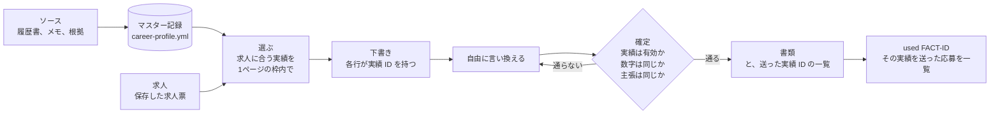
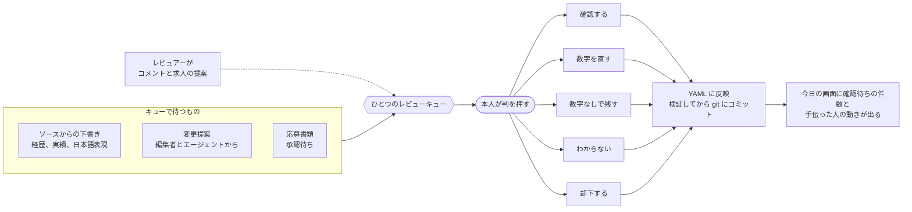
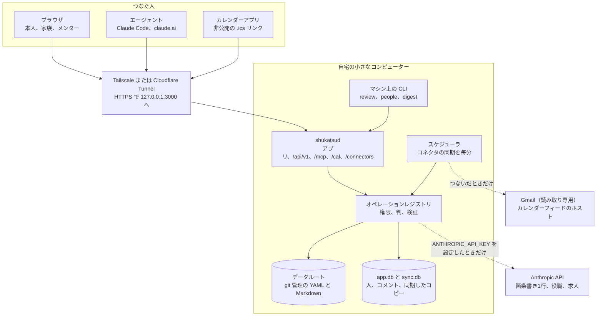
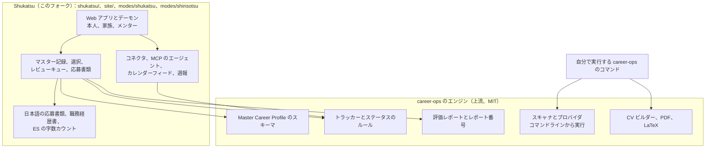

<p align="center">
  
</p>

<h1 align="center">Shukatsu</h1>

<p align="center">
Shukatsu は、就活する人がこれまでにしてきたことをひとつの記録にまとめ、書類をすべてそこから選んで作ります。<br>
家族やメンターも応募書類づくりを手伝えますが、本人が判を押すまで何も確定しません。
</p>

<p align="center">
  <a href="https://kaitosoeno.com/shukatsu/ja/">kaitosoeno.com/shukatsu</a> ·
  <a href="#インストール">インストール</a> ·
  <a href="https://github.com/pockanoodles/shukatsu/blob/main/DATAFLOW.md">データの流れ</a> ·
  <a href="https://kaitosoeno.com/ja/privacy">プライバシーポリシー</a> ·
  <a href="README.md">English</a>
</p>


<picture>
  <source media="(prefers-color-scheme: dark)" srcset="https://raw.githubusercontent.com/pockanoodles/shukatsu/main/site/public/shots/ja/dark/review.webp">
  
</picture>

スクリーンショットはサンプルの候補者のもので、画面や製品ページに出てくる名前と数字はすべて架空です。

## 何ができるか

学生の就活は、実家との電話で進むことがよくあります。親があるプロジェクトを思い出し、メンターが求人を教えてくれ、会話の中でだいたい合っていた数字がそのまま履歴書に載ってしまうことがあります。Shukatsu はそのやりとりをひとつの場所に移し、すべての記載に出どころを、すべての変更に提案者の名前を残します。

1. **記録する。** 実績は ID、タグ、出どころ、根拠とともに一か所にだけ保存されます。有効で確認済みの間だけ実績として数えられ、`cv.md` は記録から生成されます。
2. **選ぶ。** 求人ごとに合う実績を選び、箇条書きの一行一行が元の実績を宣言する下書きを作ります。選び方は決まったルールで動きモデルを使わないので、同じ記録と求人からは同じ下書きができます。
3. **チェックする。** 箇条書きは自由に言い換えられ、確定のときに宣言した実績と照らし合わせます。実績がまだ有効で、数字が同じで、文が同じ主張をしているときだけ通ります。
4. **レビューする。** 下書きと他の人からの変更提案はひとつのキューに入り、決められるのは本人だけです。決定はすべて記録に反映され、誰が提案し誰が決めたかとともに git の履歴にコミットされます。



この一覧があるので、あとから間違いに気づいた実績を、どの応募に送ったかまでさかのぼれます。`node shukatsu/master.mjs used <fact-id>` で、その実績を受け取った応募がすべて出ます。

## レビューキュー

家族やメンターの手助けが安全になるのがこのキューです。編集者とエージェントが変更を提案し、レビュアーがコメントし、判を押せるのは本人だけです。



- **数字には、はい・いいえだけの答えはありません。** 推測を確認してしまうと、それが確認済みの実績になってしまうので、数字のある項目には4つの答えがあります。記載どおり確認する、数字を直す（本人が出典になり、直した内容は `sources/review-log.md` に記録されます）、数字なしで残す、わからないにする、の4つです。
- **「わからない」は残り続けます。** その行はどの書類にも使われず、新しい項目として聞き直されることもありません。
- **却下は理由を残します。** 却下した行は削除されず、あとから開き直せます。
- **人には役割があります。** 本人がオーナーです。編集者は応募書類を最初から最後まで準備して変更を提案し、レビュアーはコメントして求人を提案し、閲覧者は見守ります。記録、トラッカー、アクセス権を変えられるのは本人だけです。
- **エージェントは作業しますが、判は押せません。** 名前をつけたエージェントは、トラッカー、評価、応募書類、カレンダー、受信箱を扱えますが、どのキーやトークンでも、実績の確認、提案の承認、送信済みの記録はできません。

## 日本語の応募書類

日本語の応募書類では、各実績の確認済みの日本語から職務経歴書を作るので、言い換えた行も、確認した表現（助数詞も含む）に照らしてチェックされます。英語の箇条書きルールの代わりに日本語の表現チェック（文体のルール、敬語のレベルをひとつにそろえる、「co-op」を使わない）が働きます。英語の数字チェックでは日本語の数字を数えられないためです。

エントリーシートやフォームの回答は応募書類の中にあります。フォームと同じ書記素単位で数え、字数制限と8割の目安に照らし、箇条書きと同じように数字もチェックします。確認済みの日本語がない実績は、レビュー項目へのリンクつきで一覧に出ます。日本語を書ける親がいちばん力になれるのがここです。

週報は LINE やメールにそのまま貼れるテキストで、日本語でも英語でも出せます（`node shukatsu/digest.mjs --lang ja`）。Shukatsu はテキストを作るところまでで、送るのは本人です。

## 動くしくみ

常駐するプロセスは `shukatsud` ひとつで、これがシステム全体です。アプリ、JSON API、MCP、非公開のカレンダーフィード、コネクタのコールバックをひとつのポートで提供し、動いている間にデータルートへ書き込むのもこのプロセスだけです。



古い Mac mini や小型 PC で動かします。デーモンは `127.0.0.1` で待ち受け、トンネル（私的な tailnet なら Tailscale、公開ホスト名なら Cloudflare Tunnel）を選ぶまで、インターネットからは届きません。公開の登録ページはなく、最初のアカウントはマシン上で作り、ほかの人は招待リンクで参加します。ログインはパスワード（scrypt）か、Face ID や Touch ID などのパスキーです。

ページ、エージェント、CLI のどこから来た操作も、権限を確認し、同じチェックを走らせ、アクティビティログを書くひとつのレジストリを通ります。そのため、アプリが断る操作をエージェントだけが実行することはできません。設計は [`shukatsu/docs/specs/v1-headless.md`](../shukatsu/docs/specs/v1-headless.md) にあります。

### 外部サービスを呼ぶもの

| 部分 | 呼び出し先 | いつ |
| --- | --- | --- |
| 表現の候補（`shukatsu/core/llm.mjs`） | Anthropic API | `ANTHROPIC_API_KEY` を設定し、応募書類でボタンを押したときだけ |
| Gmail コネクタ | `gmail.googleapis.com`、`oauth2.googleapis.com` | 本人がつないだあとだけで、読み取り専用 |
| カレンダーフィードのコネクタ | そのフィード自身のホスト | 本人がフィードのアドレスを貼ったときだけ |
| LINE コネクタ | `api.line.me` | 本人がつないだあとだけ。毎週のレポートと、トークンが有効かの毎日の確認 |
| OAuth のサインイン（`shukatsu/core/oauth.mjs`） | MCP クライアントが ID として示すアドレス（そのクライアントの公開情報） | そうしたクライアントがサインインするとき。1クライアントにつき1時間に1回まで、プライベートなアドレスには行きません |
| 名前をつけたエージェント | そのエージェントを動かすモデル | つないだとき。操作の結果がそのモデルに渡ります |

アプリの中で、これ以外に外へ出る呼び出しはありません。これらの呼び出しは、すべて `.shukatsu/egress.log` に1行ずつ（時刻、誰が、ホストまたはモデル、サイズと結果。本文は含みません）記録されます。何が送られ、誰が見られるかを平易に説明したのが [DATAFLOW.md](../DATAFLOW.md) です。

## career-ops の上に作っています

Shukatsu は、Santiago Fernández de Valderrama による [career-ops](https://github.com/career-ops-hq/career-ops)（MIT）のフォークです。トラッカー、評価レポート、求人のアーカイブを持ち、スキャナ、PDF と LaTeX のビルダー、バリデーターを提供する career-ops のエンジンをそのまま残し、その上の層を Shukatsu が加えています。



このフォーク独自のファイルは `shukatsu/` と `site/` にあり（`config/local-paths.txt` で宣言）、career-ops の更新がそこに書き込むことはありません。デーモンはエンジンのトラッカー、レポート番号、ステータス、プロフィール検証のスクリプトをローカルのプロセスとして呼びますが、エンジンのスキャナは実行しません。

Shukatsu は独立したフォークで、career-ops とは提携しておらず、career-ops から推奨も受けていません。career-ops の名称とロゴは、その作者が[商標ポリシー](../TRADEMARK.md)で留保しており、上流の [LICENSE](../LICENSE) と著作権表示はそのまま残しています。エンジン単体でできること（求人ボードのスキャン、PDF の生成、評価モードなど）は [career-ops の README](https://github.com/career-ops-hq/career-ops#readme) を見てください。

## インストール

Node 22.13 以降（組み込みの `node:sqlite` のため）、`git`、`unzip` が必要です。RAM 4 GB と数 GB のディスクがあれば足り、ページが開かれるまでは何も動きません。

```bash
git clone https://github.com/pockanoodles/shukatsu.git shukatsu
cd shukatsu
npm install                                  # career-ops エンジンの依存パッケージ
cd shukatsu && npm install && cp .env.example .env && cd ..
```

記録は、別の非公開のデータルートに置きます。フォルダを作り、リモートなしで git 管理にして、チェックアウトからそこを指すようにします。インポートはそのフォルダの `cv.md` を読み、見つけた内容をプレビューし、`--review` をつけると、保存する前に1件ずつ承認、編集、スキップを聞いてきます。

```bash
mkdir ~/resume && git -C ~/resume init
echo "$HOME/resume" > .career-ops-data      # リポジトリのルートで
cp /path/to/your-cv.md ~/resume/cv.md
node career-profile.mjs import cv.md --review
node shukatsu/master.mjs validate
```

そのあと `shukatsu/shukatsu` でデーモンを起動します。

```bash
npm run dev                    # ホットリロード、http://localhost:3000
npm test                       # エンジンのテスト。使うのはテスト用のデータルートで、本物ではありません
npm run build && npm start     # 本番
```

新規インストールの最初の起動では、本人のアカウントを作る一度きりのリンクが表示されます（`node shukatsu/people.mjs init --name "Your Name"` でも同じです）。ほかの人は「人」ページか `node shukatsu/people.mjs invite --name Mom --role editor --lang ja` で招待し、それぞれのリンクを LINE や iMessage で送ります。

自宅のマシンで動かす手順は [`shukatsu/deploy/README.md`](../shukatsu/deploy/README.md) に最初から最後まであります。systemd と launchd のサービス、Tailscale と Cloudflare Tunnel の設定、暗号化したディスクへの毎日のバックアップ、更新のしかたです。CLI とアプリの全ページは [`shukatsu/README.md`](../shukatsu/README.md) にまとめています。

## インターフェース

- **Web アプリ。** 今日、レビュー、記録、応募、応募書類、キャンペーン、カレンダー、受信箱、週報のページがあり、英語と日本語に対応しています。
- **CLI。** `shukatsu/` の `master`、`review`、`people`、`digest`、`bullet-lint`、`audit-materials`、`char-count` です。書き込みをするものは、デーモンが動いていればその API を通り、動いていなければ自分のプロセスの中で同じレジストリを通ります。
- **HTTP API。** `/api/v1` で、すべての操作を JSON で扱えます。
- **MCP。** Claude Code にはデーモンの `/mcp` を、claude.ai やスマートフォンにはカスタムコネクタとして使います（OAuth で、どのエージェントにするかを選びます）。`npm run mcp` はデーモンに転送する stdio のブリッジです。
- **カレンダー。** 人ごとの非公開の `.ics` リンクを、Apple カレンダー、Google カレンダー、Outlook で購読できます。リンクは1本ずつ取り消せます。
- **Send to Shukatsu。** 読んでいる求人のテキストを求人票として保存するブックマークレットで、API がなくログインが必要な求人ボードのために使います。

## 求人の探し方

Shukatsu は、使っている人たちから求人を受け取ります。本人、編集者、レビュアー、エージェントが URL で求人を提案でき、本人はログイン済みで読んでいるページから求人を取り込めます。取り込んだテキストはデータルートに保存され、ほかには送られません。求人とそこから取り込んだ内容は外部のテキストとして扱われ、エージェントは情報としては読みますが、指示としては読みません。

デーモンは求人ボードを定期的にスキャンしません。このチェックアウトにある career-ops のエンジンは、コマンドを実行したときにボードをスキャンでき、サイトのルールが問題になるのはそこです。公開の ATS API（Greenhouse、Ashby、Lever など）と、多数のボード専用プロバイダを読み、その一部は Web ページを解析します。各サイトの利用規約と `robots.txt` を守るのは使う人の責任で、公開の ATS API は読まれるために存在するので、いちばん安全な情報源です。ログインの壁や bot 対策を回避する目的で Shukatsu やエンジンを使ってはいけません。各プロバイダがどう読んでいるかは[対応ボード一覧](../docs/SUPPORTED_JOB_BOARDS.md)にあり、[LEGAL_DISCLAIMER.md](../LEGAL_DISCLAIMER.md) も適用されます。

## プライバシー

Shukatsu には作者が運営するサーバーも、作者に作るアカウントも、アクセス解析もテレメトリもないので、作者には何も届きません。すべてのデータは動かしているマシンの中にあり、標準で外に出るのは、選んだトンネルの暗号化された通信だけです。上に挙げたオプションのサービスが送るのは [DATAFLOW.md](../DATAFLOW.md) に書いた内容だけで、製品ページのポリシーは [kaitosoeno.com/ja/privacy](https://kaitosoeno.com/ja/privacy) にあります。

## フォークの保守

Shukatsu は career-ops のリリースごとに、そのタグを専用のブランチでマージします。使うのは次のスクリプトひとつです。

```bash
node shukatsu/upstream.mjs review      # 最新リリースの変更のうち、ここに関係するもの
node shukatsu/upstream.mjs merge       # update/<version> ブランチでマージ（コミットはしない）
node shukatsu/upstream.mjs pick <sha>  # リリースの合間に上流の修正をひとつ取り込む
```

review は4つを一覧にします。アプリが頼っているエンジンのコード（シーム。`shukatsu/core/seam.mjs` で宣言し、`shukatsu/tests/seam.spec.mjs` でテストしています）、リリースで増えたネットワーク通信（それぞれ [DATAFLOW.md](../DATAFLOW.md) に1行必要です）、エージェントへの指示とモードの変更、そしてフォークが手を入れている上流のファイルです。merge は、フォークが一度も編集していないファイルの衝突を上流の版で解決し、残りは人に任せます。`shukatsu/` での `npm test` が通り、`node test-all.mjs`（上流のテストが本物のデータルートに触れないよう、`CAREER_OPS_DATA_DIR` をこのチェックアウトにして実行）で `main` にない失敗が出ないことを確かめてから、リリースを `main` に入れます。取り込むのはリリースだけで、`upstream/main` は取り込みません。`update-system.mjs apply` も使いません。apply はマージではなくファイルのコピーなので、フォークが編集したファイルには上流の変更が届かなくなり、git も何がマージ済みかを追えなくなるからです。

Shukatsu 独自の作業は `shukatsu/`、`site/`、2つのモードフォルダ（`config/local-paths.txt` で宣言）にあるので、ほとんどのファイルは上流のもので、問題なくマージできます。この README と英語版も Shukatsu 独自のもので、`.github/` に置いています。GitHub はルートの `README.md` の代わりに `.github/` の README を表示するからです。ルートの `README.md` とその翻訳（`README.es.md` など）は上流のままなので、ほかの上流のファイルと同じようにマージされ、Shukatsu ではなく career-ops について書かれています。

フォークが上流のコードに入れた修正は、issue とプルリクエストで上流に送り、フォークで抱え続けないようにします。リリースに同じ内容が入ると review がその編集を「adopted」と表示するので、フォーク側の編集は消せます。

## ライセンス

上流と同じ MIT です。[LICENSE](../LICENSE) を見てください。Shukatsu 独自の追加部分も同じライセンスで公開しており、career-ops のコードの著作権は元の作者に残っています。Shukatsu は [Kaito Soeno](https://kaitosoeno.com/ja) が作っています。
