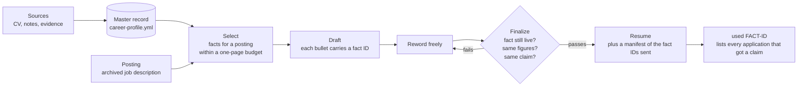
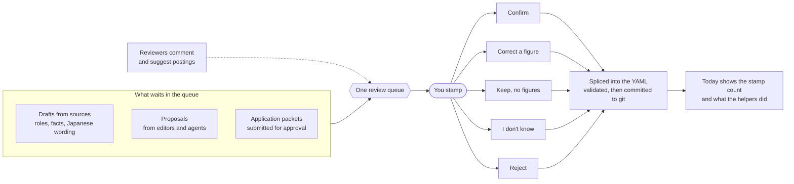
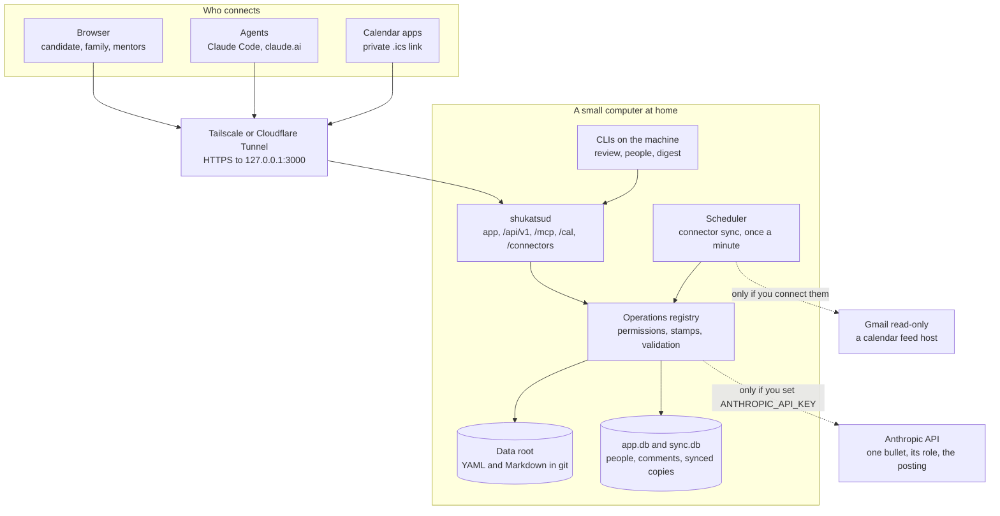
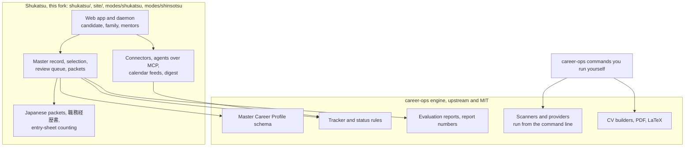

<p align="center">
  
</p>

<h1 align="center">Shukatsu</h1>

<p align="center">
Shukatsu keeps one record of everything a job seeker has done, and every resume is a selection from it.
Family and mentors can help write applications, but nothing counts until the candidate stamps it.
</p>

<p align="center">
  <a href="https://kaitosoeno.com/shukatsu/">kaitosoeno.com/shukatsu</a> ·
  <a href="#install">Install</a> ·
  <a href="https://github.com/pockanoodles/shukatsu/blob/main/DATAFLOW.md">Data flow</a> ·
  <a href="https://kaitosoeno.com/privacy">Privacy policy</a> ·
  <a href="https://github.com/pockanoodles/shukatsu/blob/main/README.ja.md">日本語</a>
</p>


<picture>
  <source media="(prefers-color-scheme: dark)" srcset="https://raw.githubusercontent.com/pockanoodles/shukatsu/main/site/public/shots/en/dark/review.webp">
  
</picture>

The screenshot shows an example candidate, and every name and figure in it and on the product page is made up.

## What it does

A student's job search often runs through phone calls home. A parent remembers a project, a mentor suggests a posting, and a number that was close enough in conversation ends up on a resume. Shukatsu moves that conversation into one place where each claim has a source and each change has a named author.

1. **Record.** Every achievement is stored once, with an ID, tags, where it came from and its evidence. A fact counts only while it is active and verified, and `cv.md` is generated from the record.
2. **Select.** For each posting, Shukatsu picks the facts that fit and writes a draft in which every bullet declares the fact it states. The pick is deterministic and uses no model, so the same record and posting give the same draft.
3. **Check.** You can reword any bullet, and finalizing compares each one with the fact it declares. A bullet passes only if the fact is still live, the figures are unchanged and the sentence still makes the same claim.
4. **Review.** Drafts and changes proposed by other people share one queue, and only the candidate decides. Each decision is written to the record and committed to its git history with who proposed it and who decided.



The manifest is what makes a retired claim recallable. If a fact turns out to be wrong later, `node shukatsu/master.mjs used <fact-id>` lists every application that received it.

## The review queue

The queue is where help from family and mentors becomes safe. Editors and agents propose changes, reviewers comment, and the candidate is the only one who can stamp.



- **A figure never gets a bare yes or no.** A confirmed guess would turn into a verified fact, so anything carrying a figure has four answers. You can confirm it as written, correct it (you become the source, and the correction is cited in `sources/review-log.md`), keep the claim without the figure, or say you don't know.
- **"I don't know" is durable.** The line stays out of every resume and is never asked again as if it were new.
- **Reject keeps the reason.** A rejected line is never deleted and can be reopened.
- **The people have roles.** The candidate is the owner. Editors prepare whole application packets and propose changes, reviewers comment and suggest postings, and viewers follow along. Only the candidate can change the record, the tracker or who has access.
- **Agents work and never stamp.** An agent you name can run the tracker, evaluations, packets, the calendar and the inbox, and no key or token can confirm a fact, accept a proposal or mark something sent.

## Japanese applications

A Japanese packet renders a 職務経歴書 from each fact's confirmed Japanese, so a reworded line is held to the wording you confirmed, counters included. The English bullet rules are replaced by a Japanese style gate (voice rules, one politeness register, no "co-op"), because the English figure check cannot count Japanese figures.

Written answers for entry sheets and forms live on the packet. They are counted by grapheme the way forms count, held to their limit and to the 80% fill norm, and checked for figures like bullets are. A fact with no confirmed Japanese is listed with a link to its review item, which is where a parent who writes Japanese helps most.

The weekly digest is copy-ready text in Japanese or English for LINE or email (`node shukatsu/digest.mjs --lang ja`). Shukatsu produces the text and leaves the sending to you.

## How it runs

One long-running process, `shukatsud`, is the whole system. It serves the app, the JSON API, the MCP endpoint, the private calendar feeds and the connector callbacks on one port, and it is the only process that writes to the data root while it runs.



An old Mac mini or a small PC runs it. The daemon listens on `127.0.0.1`, and nothing is reachable from the open internet until you choose a tunnel (Tailscale for a private tailnet, or Cloudflare Tunnel for a public hostname). There is no public sign-up, because the first account is created from the machine itself and everyone else joins by an invite link. Sign-in is a password (scrypt) or a passkey such as Face ID or Touch ID.

Every operation, whether it comes from a page, an agent or the CLI, goes through one registry that checks permissions, runs the same gates and writes the activity log. That is why an agent cannot do something the app would refuse. The design is in [`shukatsu/docs/specs/v1-headless.md`](shukatsu/docs/specs/v1-headless.md).

### What calls an outside service

| Part | Calls | When |
| --- | --- | --- |
| Suggest wordings (`shukatsu/core/llm.mjs`) | Anthropic API | Only when `ANTHROPIC_API_KEY` is set and someone presses the button on a packet |
| Gmail connector | `gmail.googleapis.com`, `oauth2.googleapis.com` | Only after the candidate connects it, and read-only |
| Calendar feed connector | The feed's own host | Only after the candidate pastes a feed address |
| Agents you name | Whatever model runs the agent | When you connect one, and it receives what its operations return |

Nothing else in the app calls out. Every connector request and every model call writes one line to `.shukatsu/egress.log` (time, who, host or model, sizes and status, never the text). The plain-language version, with what is sent and who can see it, is [DATAFLOW.md](DATAFLOW.md).

## Built on career-ops

Shukatsu is a fork of [career-ops](https://github.com/career-ops-hq/career-ops) by Santiago Fernández de Valderrama (MIT). The fork keeps career-ops' engine, which holds the tracker, the evaluation reports and the posting archive, and which provides the scanners, the PDF and LaTeX builders and the validators. Shukatsu adds the layer on top of it.



The fork's own files live under `shukatsu/` and `site/` (declared in `config/local-paths.txt`), so career-ops updates never write to them. The daemon calls the engine's tracker, report-number, status and profile-validation scripts as local processes, and it never runs the engine's scanners.

Shukatsu is an independent fork and is not affiliated with or endorsed by career-ops. The career-ops name and logos are reserved by its authors under their [trademark policy](TRADEMARK.md), and the upstream [LICENSE](LICENSE) and copyright notice are kept. For everything the engine does on its own, such as scanning boards, building PDFs and the evaluation modes, see the [career-ops README](https://github.com/career-ops-hq/career-ops#readme).

## Install

You need Node 22.13 or newer (for the built-in `node:sqlite`), `git` and `unzip`. A machine with 4 GB of RAM and a few GB of disk is enough, and nothing runs until someone opens a page.

```bash
git clone https://github.com/pockanoodles/shukatsu.git shukatsu
cd shukatsu
npm install                                  # the career-ops engine's dependencies
cd shukatsu && npm install && cp .env.example .env && cd ..
```

The record lives in a separate private data root. Make a folder for it, put it under git with no remote, and point the checkout at it. The import reads `cv.md` from that folder, previews what it finds, and with `--review` asks you to approve, edit or skip each item before anything is saved.

```bash
mkdir ~/resume && git -C ~/resume init
echo "$HOME/resume" > .career-ops-data      # from the repo root
cp /path/to/your-cv.md ~/resume/cv.md
node career-profile.mjs import cv.md --review
node shukatsu/master.mjs validate
```

Then start the daemon from `shukatsu/shukatsu`.

```bash
npm run dev                    # hot reload at http://localhost:3000
npm test                       # engine tests, on a fixture data root and never yours
npm run build && npm start     # production
```

On a fresh install the first start prints a one-time link that creates the candidate's account (`node shukatsu/people.mjs init --name "Your Name"` does the same). Invite everyone else from the People page or with `node shukatsu/people.mjs invite --name Mom --role editor --lang ja`, and send each link over LINE or iMessage.

[`shukatsu/deploy/README.md`](shukatsu/deploy/README.md) covers the home machine end to end, with the systemd and launchd services, the Tailscale and Cloudflare Tunnel setups, the daily backup to an encrypted disk, and updating. [`shukatsu/README.md`](shukatsu/README.md) lists the CLIs and every page of the app.

## Interfaces

- **Web app.** The Today, Review, Record, Applications, Packets, Campaigns, Calendar, Inbox and Digest pages, in English and Japanese.
- **CLI.** `master`, `review`, `people`, `digest`, `bullet-lint`, `audit-materials` and `char-count` in `shukatsu/`. The writing ones go through the daemon's API when it is running, and through the same registry in their own process when it is not.
- **HTTP API.** `/api/v1`, with every operation as JSON.
- **MCP.** `/mcp` on the daemon for Claude Code, and as a custom connector for claude.ai and phones (OAuth, where you choose which agent it gets). `npm run mcp` is a stdio bridge that forwards to the daemon.
- **Calendar.** A private `.ics` link per person that Apple Calendar, Google Calendar or Outlook can subscribe to, and any one link can be revoked alone.
- **Send to Shukatsu.** A bookmarklet that saves the text of the posting you are reading as the archived job description, for boards with no API and a sign-in wall.

## Finding postings

Shukatsu takes postings from the people using it. The candidate, editors, reviewers and agents can suggest a posting by URL, and the candidate can capture a posting from a page they are signed in to read. Captured text is saved to the data root and sent nowhere else. Postings and anything captured from them are treated as outside text, which an agent reads as information and never as instructions.

The daemon does not scan job boards on a schedule. The career-ops engine in this checkout can scan boards when you run its commands, and that is where site rules matter. It reads public ATS APIs (Greenhouse, Ashby, Lever and similar) and a long list of board-specific providers, and some of those parse web pages. You are responsible for following each site's terms of use and `robots.txt`, and public ATS APIs are the safest source because they exist to be read. Shukatsu and the engine should never be used to get around a login wall or bot protection. The [supported boards list](docs/SUPPORTED_JOB_BOARDS.md) records how each provider reads its source, and [LEGAL_DISCLAIMER.md](LEGAL_DISCLAIMER.md) applies as well.

## Privacy

Shukatsu has no server run by its author, no account to create with the author, no analytics and no telemetry, so the author receives nothing. Everything lives on the machine you run it on, and by default the only thing that leaves it is the encrypted traffic of the tunnel you choose. The few opt-in services above send only what [DATAFLOW.md](DATAFLOW.md) lists, and the policy for the product page is at [kaitosoeno.com/privacy](https://kaitosoeno.com/privacy).

## Maintaining the fork

Shukatsu takes each career-ops release by merging its tag on a branch of its own, through one script:

```bash
node shukatsu/upstream.mjs review      # what the newest release changes that matters here
node shukatsu/upstream.mjs merge       # merges it on update/<version>, uncommitted
node shukatsu/upstream.mjs pick <sha>  # one upstream fix between releases
```

The review lists four things: the engine code the app depends on (the seam, declared in `shukatsu/core/seam.mjs` and tested in `shukatsu/tests/seam.spec.mjs`), the network calls the release adds, each of which needs a line in [DATAFLOW.md](DATAFLOW.md), changes to the agent instructions and modes, and the upstream files the fork edits. The merge resolves conflicts in files the fork never edited to upstream's version and leaves the rest for a person. The release reaches `main` once `npm test` in `shukatsu/` passes and `node test-all.mjs` (run with `CAREER_OPS_DATA_DIR` set to the checkout, so upstream's tests stay out of the real data root) shows no failure that `main` doesn't already have. Shukatsu takes releases only, never `upstream/main`, and never runs `update-system.mjs apply`, which copies files instead of merging them, so a file the fork edits stops receiving upstream changes and git loses track of what was merged.

Almost every file is upstream's and merges cleanly, because Shukatsu's own work is in `shukatsu/`, `site/` and two mode folders, declared in `config/local-paths.txt`. The exceptions are this README and `README.ja.md`, which are Shukatsu's own, and `.gitattributes` marks both `merge=ours` so a merge always keeps these versions. That attribute needs a merge driver, which is one line of git config per clone (`merge` sets it when a clone lacks it).

```bash
git config merge.ours.driver true
```

Upstream's other translated READMEs (`README.es.md` and the rest) are left untouched so they cannot conflict, and they describe career-ops rather than Shukatsu.

A fix the fork makes to upstream's code goes upstream as an issue and a pull request, so the fork doesn't carry it. The review marks a carried edit "adopted" once a release has the same content, and the fork's copy of the edit can go.

## License

MIT, the same as upstream. See [LICENSE](LICENSE). Shukatsu's own additions are released under the same license, and the career-ops code keeps its authors' copyright. Shukatsu is made by [Kaito Soeno](https://kaitosoeno.com).
